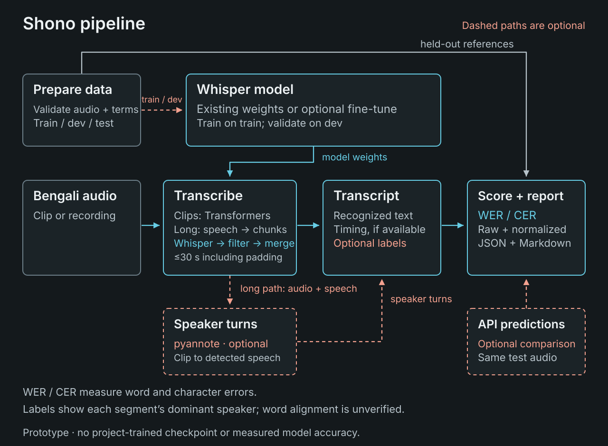

# Shono (শোনো)

Bengali speech transcription and evaluation tools in Python. Shono scores
transcripts with jiwer and bnunicodenormalizer, prepares dataset manifests, and
provides optional Whisper training and transcription workflows using PyTorch
and Transformers.



This is a prototype. The repository has no project-trained checkpoint or
measured model accuracy. GPU training and provider inference still need
validation. The included
[scorer checks](outputs/scorer-check.csv) use hand-computed text examples; their
[metadata](outputs/scorer-check.toml) and [chart](outputs/scorer-check.svg) are
committed with the code.

## Run the checks

Install [uv](https://docs.astral.sh/uv/), then clone the repository. The project
uses Python 3.11; uv installs it if needed.

```sh
git clone https://github.com/urmeo/shono
cd shono
./verify
```

`./verify` installs locked dependencies, checks lint and formatting, validates
notebook syntax, runs the offline tests, and verifies the scorer artifacts.
Training and transcription require separate runtime dependencies and inputs.

## Score transcripts

The scorer returns raw and normalized word error rate (WER) and character error
rate (CER). Both the reference and prediction use the same normalization policy.

```sh
uv run --locked python - <<'PY'
from shono.eval import score

result = score(["আমি বাংলায় কথা বলি।"], ["আমি বাংলায় কথা বলি"])
print(result)
PY
```

To generate a report from the manifests and predictions listed in
[`configs/reports/`](configs/reports/):

```sh
uv run --locked python -m shono.eval --report baselines
```

Reports are written to `outputs/`. Missing inputs or unresolved source terms
leave cells pending. Scored cells record normalization versions, input hashes,
inference settings, and confidence intervals over recording or speaker blocks.

## Training and transcription

The [data and runtime protocol](docs/PROTOCOL.md) describes input formats,
dependencies, source terms, and scoring rules. Configure the paths and run
settings before using the notebooks in this order:

1. [`prepare_data.ipynb`](notebooks/prepare_data.ipynb): validate local datasets and write manifests.
2. [`baselines.ipynb`](notebooks/baselines.ipynb): transcribe with the selected baseline checkpoints.
3. [`train_whisper_medium.ipynb`](notebooks/train_whisper_medium.ipynb): fine-tune from declared train and development splits.
4. [`predict.ipynb`](notebooks/predict.ipynb): generate predictions and reports, with optional speaker labels and cloud comparisons.

Model and cloud runs default to disabled. Long recordings use Silero speech
detection, chunking, and faster-whisper. The optional pyannote path labels each
transcript segment with its dominant speaker. Word alignment is unverified.

## License

Code uses the [MIT license](LICENSE). Datasets and model weights have separate
terms; the [source catalog](data/LICENSES.md) records the dataset status.
