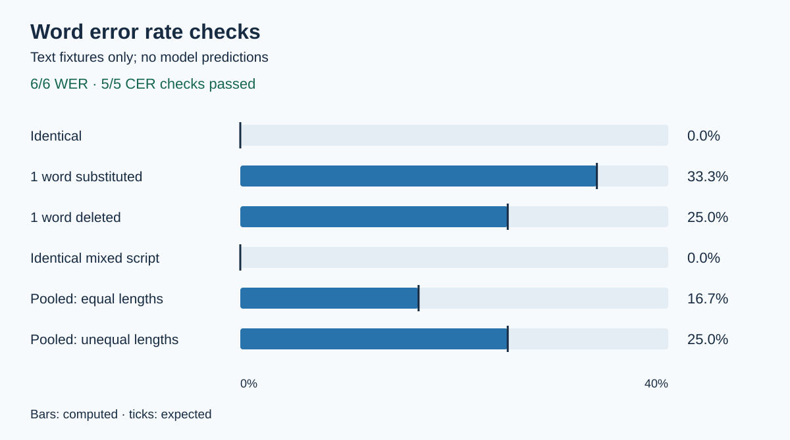
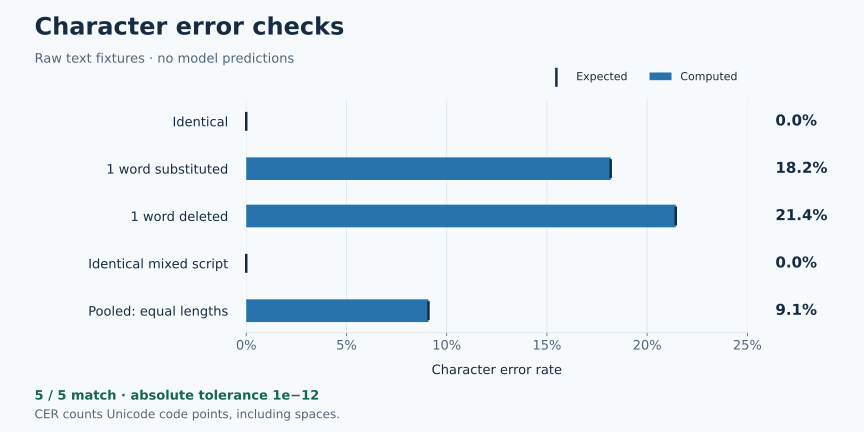
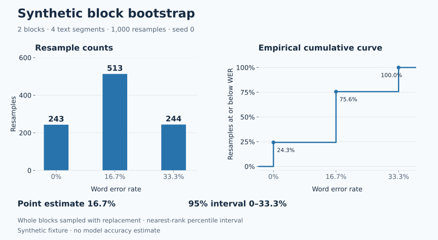

# Shono (শোনো)

Transcribe Bengali speech and measure transcript errors.

**Keywords:** PyTorch · Transformers · Whisper · Speech recognition

## Pipeline

Audio → Whisper → transcript → normalize transcript and reference → WER/CER.

## Run

<details>
<summary>Setup</summary>

Requires [uv](https://docs.astral.sh/uv/), Python 3.11, and a local Whisper checkpoint in Transformers format.

```bash
git clone https://github.com/urmeo/shono
cd shono
uv venv --python 3.11 ../shono-env
source ../shono-env/bin/activate
uv pip install -r requirements.txt
export PYTHONPATH="$PWD/src${PYTHONPATH:+:$PYTHONPATH}"
python -m shono.transcribe.convert /path/to/whisper ../shono-ct2 --quantization int8
```

</details>

```bash
python -m shono.transcribe audio.wav --model ../shono-ct2
```

First use downloads pinned Silero code and weights.

<details>
<summary>Fine-tuning</summary>

Optional fine-tuning with the default 8-bit optimizer requires bitsandbytes on a [supported platform](https://github.com/bitsandbytes-foundation/bitsandbytes/blob/0.50.1/README.md#accelerator-support):

```bash
uv pip install bitsandbytes==0.50.1
```

To use the standard PyTorch optimizer on CPU or Apple Silicon, set `optim="adamw_torch"` and `fp16=False` in `TrainConfig`.

</details>

<details>
<summary>Checks and scoring</summary>

```bash
uv pip install pytest==9.1.1
python -m pytest -q
python scripts/check_evidence.py --check
python -m shono.eval --report baselines --licenses /path/to/licenses.toml
```

Scoring requires local manifests, predictions, and a source registry.

</details>

## Results

Built-in reports compare the Bengali base checkpoint with a supplied fine-tuned checkpoint. The baseline report covers the base checkpoint only.

Synthetic checks. Bengali model accuracy is not measured.







[Scorer data](outputs/scorer-check.csv) · [Figure data](outputs/visual-checks.csv)

## Tech Stack

| Role | Tools |
| :--- | :--- |
| Runtime | Python 3.11 · PyTorch · Transformers |
| Speech | Whisper · faster-whisper · CTranslate2 · Silero VAD |
| Audio | NumPy · librosa · soundfile |

## Roadmap

- Measure WER and CER on held-out Bengali recordings.
- Validate GPU inference and fine-tuning.
- Check word timestamps on long recordings.

## References

1. Radford et al. (2022). [Robust Speech Recognition via Large-Scale Weak Supervision](https://arxiv.org/abs/2212.04356).
2. SYSTRAN. [faster-whisper](https://github.com/SYSTRAN/faster-whisper).
3. OpenNMT. [CTranslate2](https://opennmt.net/CTranslate2/).
4. [Silero VAD](https://github.com/snakers4/silero-vad).

## License

[MIT](LICENSE)
